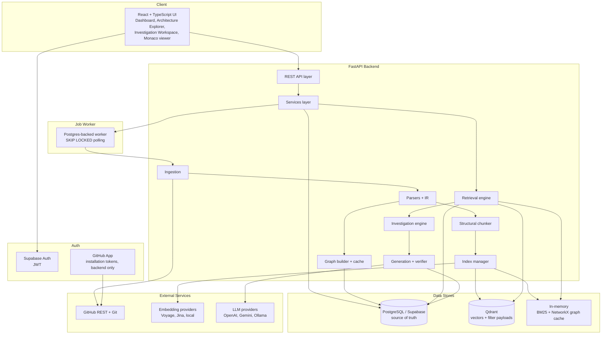
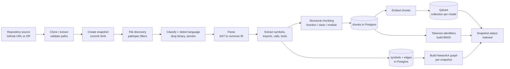
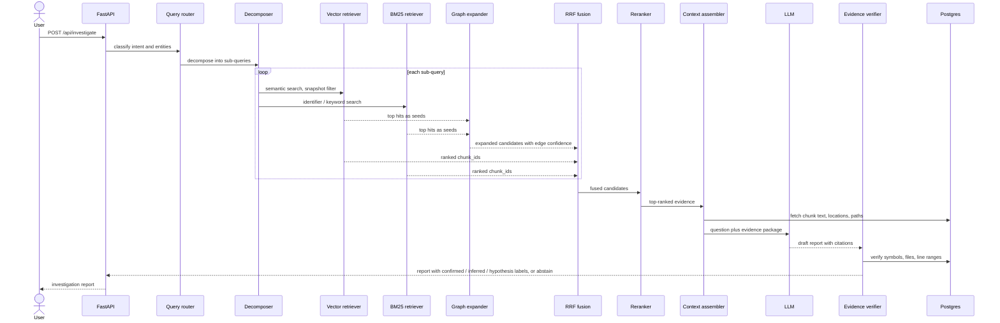
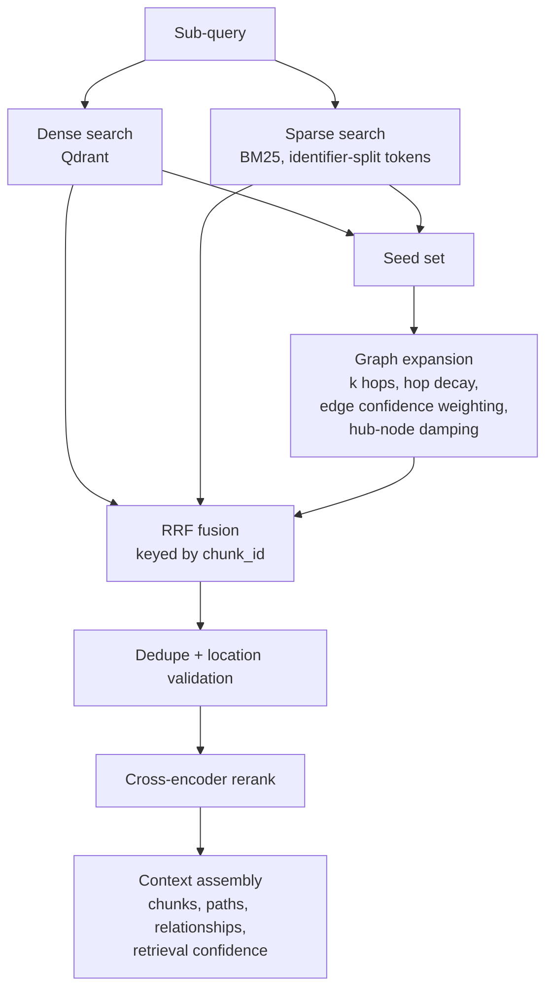
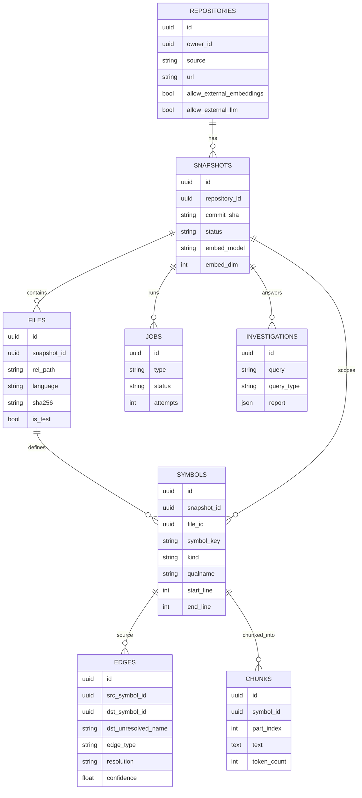
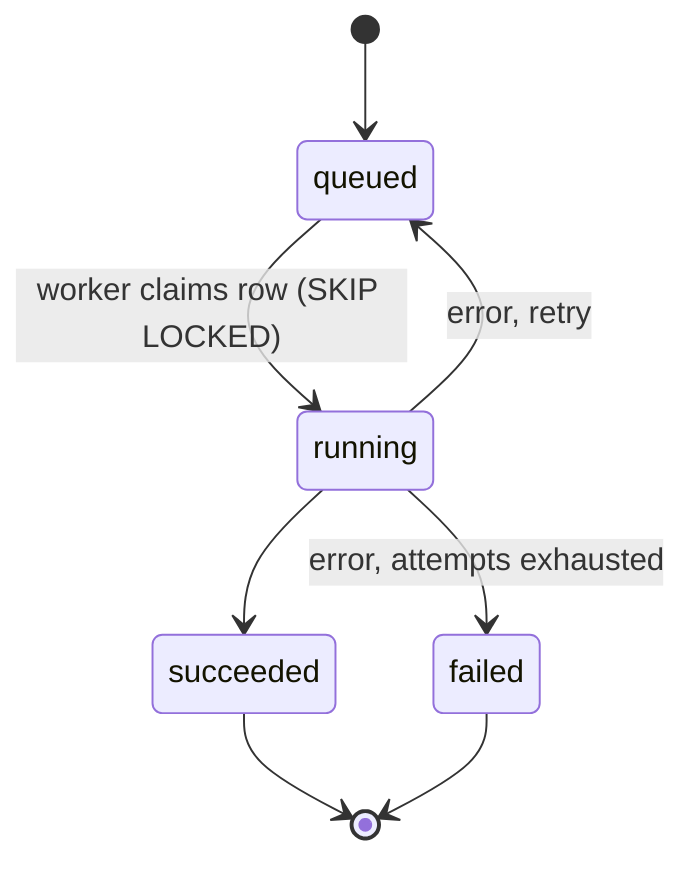
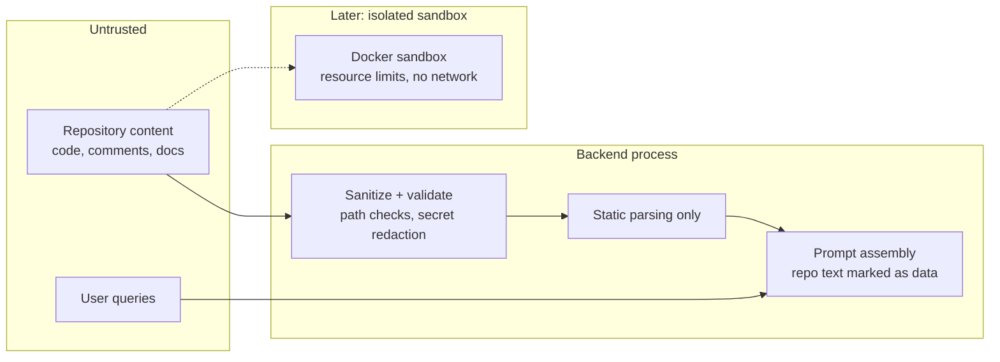
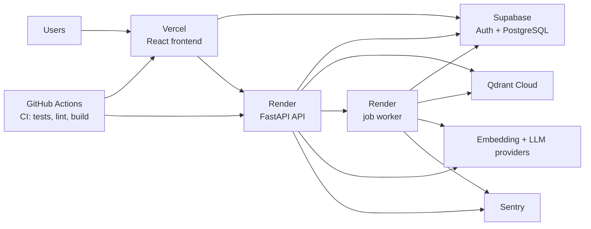

# BlackBoxRAG: System Architecture

Scope: v1 architecture (Python-first, NetworkX graph, Postgres + Qdrant). Items marked _later_ belong to v2/v3.

---

## 1. High-Level System Overview



---

## 2. Layered View

| Layer                     | Components                                                                                                                         | Backing tech                             |
| ------------------------- | ---------------------------------------------------------------------------------------------------------------------------------- | ---------------------------------------- |
| L8 Visualization          | Repository dashboard, architecture explorer, investigation workspace, execution-flow and impact views                              | React, React Flow, Monaco, Recharts      |
| L7 Response generation    | Prompt manager, answer generator, citation generator                                                                               | LiteLLM / provider abstraction, Pydantic |
| L6 Investigation engine   | Query router, decomposer, architecture, execution, root-cause, impact, dependency analyzers, evidence verifier, confidence manager | Custom Python                            |
| L5 Hybrid retrieval       | Vector, lexical and graph retrievers, RRF fusion, cross-encoder reranker, context assembler                                        | Qdrant, rank-bm25, NetworkX              |
| L4 Knowledge construction | Embedding service, Qdrant store, BM25 index, graph builder                                                                         | Voyage / Jina / local embedders          |
| L3 Code intelligence      | Parsers, symbol / import / call extractors, structural chunker                                                                     | Python `ast`, Tree-sitter (later)        |
| L2 Ingestion              | GitHub / ZIP loaders, file discovery, filtering, language detection, snapshot manager                                              | GitPython, PyGithub, pathspec            |
| L1 Interface              | REST API, auth, job submission                                                                                                     | FastAPI, Supabase Auth                   |

---

## 3. Ingestion and Indexing Pipeline



Notes:

- Nothing from the repository is executed during ingestion.
- Every artifact carries `snapshot_id`, so indexes from different commits never mix.
- Call edges are stored with `resolution` and `confidence`; unresolved calls are kept with `dst_unresolved_name`.
- Embedding runs through the external provider only if `allow_external_embeddings` is true for that repository; otherwise a local embedder is used.

---

## 4. Investigation (Query) Flow



Rules enforced at this stage:

- The LLM reasons only over the assembled evidence.
- Citations that do not resolve to a real symbol and line range are removed or flagged.
- If evidence is insufficient, the report abstains instead of guessing.

---

## 5. Retrieval Engine Detail



Ablation switches (for E1-E5): each channel (BM25, graph), reranking and verification can be enabled or disabled by configuration.

---

## 6. Data Model



Identifier scheme:

```
symbol_key = "{lang}:{rel_path}::{qualname}"   (stable across commits)
symbol_id  = uuid5(NAMESPACE, snapshot_id + symbol_key)
chunk_id   = uuid5(NAMESPACE, symbol_id + ":" + part_index)
```

---

## 7. Store Responsibilities

| Store             | Holds                                                                                           | Does not hold                           |
| ----------------- | ----------------------------------------------------------------------------------------------- | --------------------------------------- |
| PostgreSQL        | Users, repositories, snapshots, files, symbols, edges, chunks (with text), jobs, investigations | Vectors                                 |
| Qdrant            | Vectors plus filter-only payload (snapshot, file path, kind, language, is_test, symbol IDs)     | Chunk text                              |
| NetworkX (memory) | Snapshot graph built from `symbols` + `edges`, LRU cached                                       | Anything not reproducible from Postgres |
| BM25 (memory)     | Tokenized chunk corpus per snapshot                                                             | Anything not reproducible from Postgres |

Postgres is the single source of truth. Qdrant, BM25 and the graph can all be rebuilt from it.

---

## 8. Job Processing



Job types: `clone`, `parse`, `chunk`, `embed`, `build_graph`, `index_bm25`. Snapshot status advances only when its required jobs succeed. A separate worker process polls the `jobs` table, so a backend restart does not lose work. Celery and Redis are deferred.

---

## 9. Security Boundaries



- v1 never executes repository code.
- Repository text is treated as untrusted data in prompts (prompt-injection defense).
- Runtime tracing (v3) runs only in isolated containers, disabled by default.
- Private repositories default to `allow_external_embeddings = false` and `allow_external_llm = false`.
- GitHub App installation tokens never reach the frontend.

---

## 10. Deployment Topology



Local development: `docker-compose.yml` runs Postgres and Qdrant (optionally Ollama), with the API and worker running against them. Tests run migrations against a throwaway Postgres database.

---

## 11. Backend Module Map

```
app/
├── api/            REST routers
├── services/       orchestration, one service per use case
├── workers/        job runner
├── ingestion/      loaders, discovery, filtering, snapshot manager
├── parsers/        language parsers, IR, symbol / import / call extractors
├── chunking/       structural chunker and context builder
├── indexing/       embedders, qdrant_store, lexical_index, index_manager
├── graph/          builder, cache, schema, traversal, relationship scorer
├── retrieval/      query analysis, retrievers, fusion, reranker, context assembler
├── investigation/  router, decomposer, analyzers, evidence verifier
├── generation/     llm_client, prompt_manager, answer + citation generators
├── models/         SQLAlchemy models
└── schemas/        Pydantic request / response and IR schemas
```

Dependency direction: `api -> services -> {ingestion, parsers, chunking, indexing, graph, retrieval, investigation, generation} -> models`. Lower modules do not import from `api` or `services`.

---

## 12. Release Evolution

| Release   | Architecture additions                                                                                                                 |
| --------- | -------------------------------------------------------------------------------------------------------------------------------------- |
| v1.0      | Everything above except runtime and multi-language parsers                                                                             |
| v2.0      | Multi-step decomposition loop, execution-flow reconstruction, root-cause and impact engines, stronger verification, advanced dashboard |
| v3.0      | Sandbox manager, trace collector and analyzer, static-vs-dynamic comparison, additional Tree-sitter languages                          |
| If needed | Neo4j replaces NetworkX; Elasticsearch replaces in-memory BM25; Redis + Celery replace the Postgres job worker                         |
